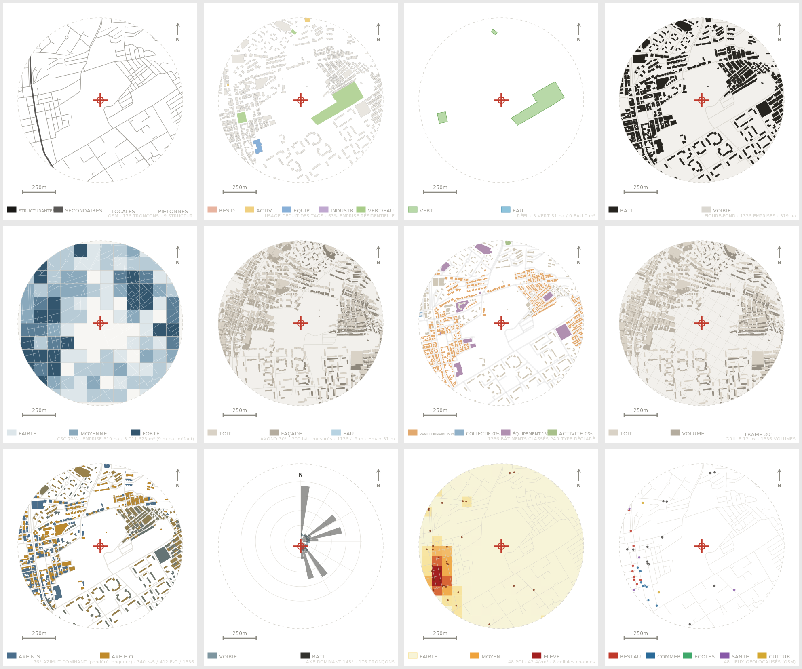
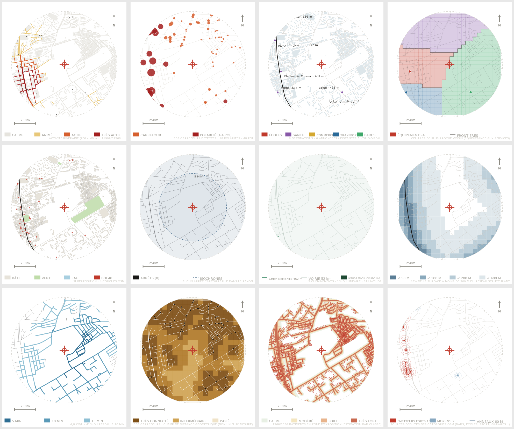
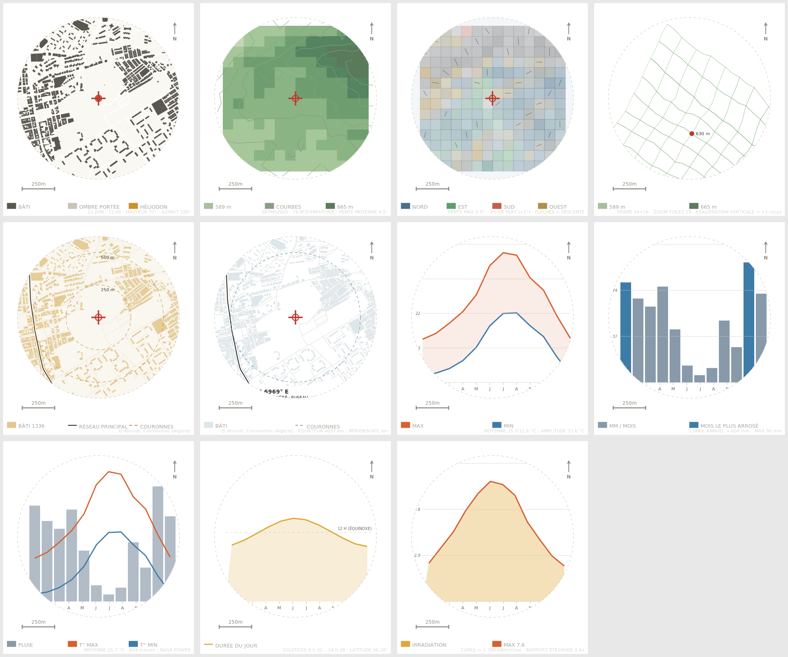

# Freemap — analyse de site architecturale

Générateur de planches d'analyse de site : **35 analyses** rendues en SVG à
partir d'OpenStreetMap, de NASA POWER et des tuiles d'altitude AWS Terrarium.
Le plan est calculé par un module partagé entre le navigateur et le serveur,
les licences sont des titres signés Ed25519 liés à l'appareil, et l'application
fonctionne sans réseau grâce à un extrait embarqué.

> **Origine du projet.** Freemap est né d'un travail de rétro-ingénierie :
> comprendre l'architecture d'un générateur de planches d'analyse de site, puis
> en écrire une mise en œuvre indépendante. Aucune ligne de code, aucun texte et
> aucune donnée de ce service n'ont été repris ; le catalogue des analyses, les
> rendus, les textes et le catalogue de licences sont les nôtres. Le projet
> n'est **affilié à aucun éditeur tiers**.

[](LICENSE)
[](package.json)
[](package.json)
[](#bancs-d-essai)

[](https://github.com/freemind25/freemap/actions/workflows/ci.yml)





*Les 35 analyses sur El Khroub (Constantine, Algérie), rayon 600 m, sans
filigrane — la vue de l'essai gratuit est filigranée.*

## Démarrage

Aucune dépendance à installer : Node.js 20.11 et rien d'autre.

```bash
git clone https://github.com/freemind25/freemap.git
cd freemap
npm start                  # http://localhost:4173
```

Pour voir l'application en action sans attendre Overpass, ouvrez
<http://localhost:4173/?sample=1> : l'exemple embarqué (El Khroub, 600 m,
1 577 éléments réels) se charge immédiatement.

## Ce que fait l'application

- **35 analyses** de 240 × 268 : voirie, tissu urbain, densité, volumétrie
  axonométrique, typologie, trames, orientations, POI, vitalité, mobilité,
  bruit, ensoleillement, relief, climat (températures, pluie, ensoleillement,
  durée du jour).
- **Recherche de lieu** (Nominatim) ou coordonnées directes, rayon de 200 à
  3 000 m, périmètre circulaire ou polygonal.
- **Exports** : SVG unitaire, PNG, « tout exporter », planche A3 pour
  l'impression.
- **Interface bilingue** français/anglais (`?lang=en`), thème clair ou sombre
  selon l'analyse, six palettes de couleurs.
- **Paliers** : 4 analyses en essai gratuit (filigranées), 23 en Pro, 8 en Max.

## Structure du dépôt

```
.
├── public/                  interface servie telle quelle (aucune compilation)
│   ├── index.html           coquille : panneaux, grille de cartes, modales
│   ├── styles.css           chrome sombre, impression A3 paysage
│   ├── favicon.svg
│   ├── data/                exemple embarqué (El Khroub, 855 Ko)
│   └── js/
│       ├── catalog.js       44 entrées de catalogue, 7 groupes FR/EN
│       ├── engine.js        moteur : wrap(), palettes, géométrie, légendes
│       ├── renderers-core.js  11 analyses gratuites
│       ├── renderers-pro.js   24 analyses sous licence
│       ├── plan-2d.mjs  planificateur partagé navigateur/serveur
│       ├── osm.mjs          normalisation des données OpenStreetMap
│       ├── routes.mjs       client HTTP, codes d'erreur FR/EN, repli direct
│       ├── persist.mjs      cache IndexedDB, préférences locales
│       └── app.js           orchestration, i18n, exports, état
├── api/                     fonctions serverless (Vercel) : analysis/2d · status · util
├── server/
│   ├── index.mjs            point d'entrée, createApp(), CLI
│   ├── api.mjs              contrat HTTP (gestionnaires réutilisés par les deux modes)
│   ├── runtime.mjs          où vit l'état : mode « node » ou « vercel »
│   ├── licence.mjs          clés Ed25519, codes, titres signés
│   ├── quota.mjs            une génération en vol par IP
│   ├── runs.mjs             sessions de génération
│   ├── http.mjs             envoi, corps, IP, fichiers statiques
│   ├── config.mjs           chemins, sources, délais
│   └── sources/             overpass · climate · terrain
├── test/                    5 fichiers de bancs d'essai, 135 tests
├── tools/                   capture d'exemple, rendu SVG, contrôle de syntaxe
├── docs/                    architecture, API, données, déploiement, journal
└── .github/                 CI, gabarits d'issues et de proposition
```

Le détail des choix se trouve dans **[docs/ARCHITECTURE.md](docs/ARCHITECTURE.md)**.

## API

| Route | Objet |
|---|---|
| `GET /api/status` | version, paliers, plafonds de rayon, clé publique Ed25519 |
| `POST /analysis/2d` | `check` · `begin` · `query` · `end` · `activate` · `terrain` · `climate` |
| `POST /` | `geocode=` · `refcheck=` · `refcode=` |

Le client n'envoie jamais de requête Overpass : il envoie des identifiants
d'analyse, un rayon et un point ; le serveur reconstruit la requête avec le
planificateur partagé. Contrat complet et codes d'erreur :
**[docs/API.md](docs/API.md)**.

## Licences et paliers

| Palier | Débloque | Obtention |
|---|---|---|
| essai (`free`) | `roads`, `landuse`, `gw`, `fabric` | par défaut, cartes filigranées |
| `pro` | + 15 analyses d'étude | code de licence |
| `max` | les 35 analyses | code de licence |

Codes de démonstration fournis par le dépôt (`DEMO_CODES`) :

| Code | Palier |
|---|---|
| `cs_demo_pro` | pro, 30 jours |
| `cs_demo_max` | max, 30 jours |
| `cs_etude_2026` | max, 90 jours |
| `cs_demo_lifetime` | max, sans expiration |

Un code s'active dans *Tarifs* ; il est lié à un identifiant d'appareil et le
titre signé est vérifié **dans le navigateur** (`crypto.subtle`) avant d'ouvrir
l'accès. Modifier `localStorage` ne donne donc rien. Avant une mise en ligne,
remplacez ces codes et lisez [SECURITY.md](SECURITY.md).

## Vue 3D

Les bâtiments peuvent être affichés **en volume**, avec ombres portées selon
l'heure et le lieu (comme sur `osmbuildings.org`, dont les fonctions ont été
relevées puis réimplémentées sans dépendance) :

- analyse **Volumes 3D** dans le catalogue, exportable comme les autres ;
- **vue interactive** plein écran (bouton `3D` ou `?vue3d=1`) : rotation,
  inclinaison, zoom, curseur d'heure, fiche au clic, fond de carte optionnel,
  export PNG et SVG.

Deux sources de hauteurs : nos requêtes Overpass (autonome) ou les tuiles
d'osmbuildings.org, qui fournissent une hauteur pour chaque bâtiment.
Détail et limites : **[docs/VUE3D.md](docs/VUE3D.md)**.

## Accès : période d'essai ouverte

**Aujourd'hui, tout est ouvert** : les 35 analyses, sans licence, sans
filigrane et sans quota. C'est le mode par défaut.

```
FM_ACCESS=open      # défaut — toutes les analyses pour tout le monde
FM_ACCESS=licence   # 4 analyses gratuites filigranées, Pro/Max sur code, quota par IP
```

Le serveur annonce son mode dans `/api/status` (champ `access`) et le client
s'y adapte seul : catalogue déverrouillé, filigrane retiré, badge « LIBRE ».
Le jour où les abonnements reviennent, il suffit de basculer la variable.
Détail et marche à suivre : **[docs/ACCES.md](docs/ACCES.md)**.

## Bancs d'essai

```bash
npm test          # tests hors ligne (aucun accès réseau requis)
npm run test:net  # + Overpass, Nominatim, NASA POWER, Terrarium
npm run lint      # contrôle de syntaxe de tout le dépôt
npm run svg -- --ids massing,gw --png   # rendus hors navigateur
npm run capture   # recapture l'exemple embarqué depuis les sources réelles
npm run genere-cle   # clé de signature Ed25519 (serveur : fichier · Vercel : variable)
```

Les tests couvrent le rendu des 35 analyses et de leurs palettes, la cohérence
du catalogue et du planificateur, les licences (signature vérifiée
indépendamment du serveur), le contrat HTTP, le quota, l'accès libre et le basculement
en régime sous licence, le repli entre miroirs Overpass, la vue 3D (soleil,
caméra, ombres, désignation au clic, lecture des deux sources), le décodeur PNG
des tuiles d'altitude et la projection Mercator.

## Déploiement

Deux modes, selon l'endroit où le serveur tourne :

| Mode | Où | Ce que vous obtenez |
|---|---|---|
| **Serveur Node** (défaut) | VPS, Docker, Render, Railway | tout : quota par IP, licences révocables, clé sur disque |
| **Serverless** | Vercel | tout sauf la révocation et le quota global : l'état vit en mémoire d'instance |

À ceci près : en accès libre (le défaut), ni licence ni quota intervient, donc
les deux modes se comportent pareil pour l'utilisateur.

Sur Vercel, l'API est exposée par trois fonctions (`api/`) et le reste est
servi en statique ; il faut poser une variable d'environnement pour que les
licences fonctionnent. Détail, limites et vérifications :
**[docs/VERCEL.md](docs/VERCEL.md)**.

Pour le serveur classique (variables d'environnement, systemd, Docker, points
de vigilance) : **[docs/DEPLOIEMENT.md](docs/DEPLOIEMENT.md)**. À retenir avant
toute mise en ligne : sauvegarder la clé privée de signature, remplacer les
codes de démonstration, régler le `User-Agent` sur votre contact, et rendre le
quota partagé si vous lancez plusieurs instances.

## Données et attribution

| Donnée | Source | Licence |
|---|---|---|
| Voirie, bâti, usage, POI, transports | OpenStreetMap via Overpass | ODbL 1.0 — `© OpenStreetMap contributors` |
| Altimétrie | AWS Terrarium (SRTM, USGS, EU-DEM) | domaine public |
| Climat | NASA POWER | domaine public |

Les planches publiées doivent porter l'attribution OSM. Détail et implications
de l'ODbL : **[docs/DONNEES.md](docs/DONNEES.md)**.

## État du projet

Version 0.1.0, voir [CHANGELOG.md](CHANGELOG.md). 9 analyses sur 44 sont
déclarées au catalogue sans rendu (planches composées, vent, réseau radial) et
apparaissent avec le badge « v0.2 ». Le parrainage répond mais n'applique aucune
remise. Les suites prévues sont listées dans
[docs/JOURNAL-DEV.md](docs/JOURNAL-DEV.md#9-reste-à-faire).

## Contribuer

Les propositions sont bienvenues : voir [CONTRIBUTING.md](CONTRIBUTING.md)
(conventions, ajout d'une analyse en trois fichiers) et
[CODE_OF_CONDUCT.md](CODE_OF_CONDUCT.md). Les défauts se signalent avec le
gabarit d'issue, en précisant l'analyse, le lieu et le rayon.

## Licence

Code sous [MIT](LICENSE). Les données restent sous les licences de leurs
producteurs.
