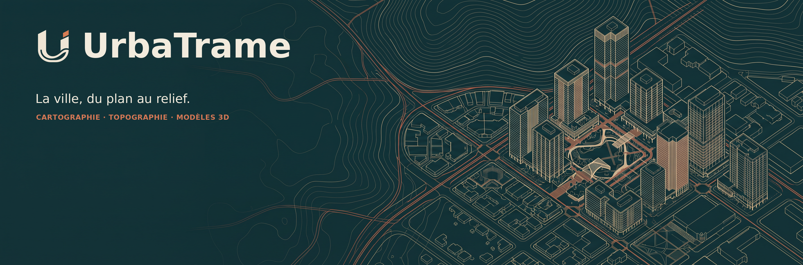
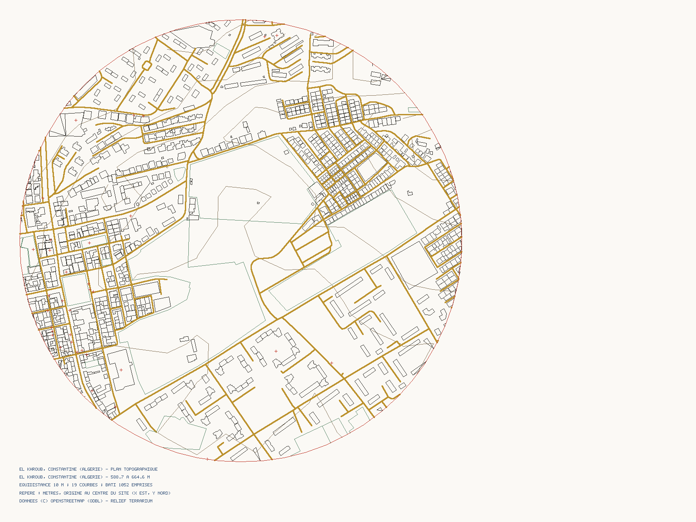
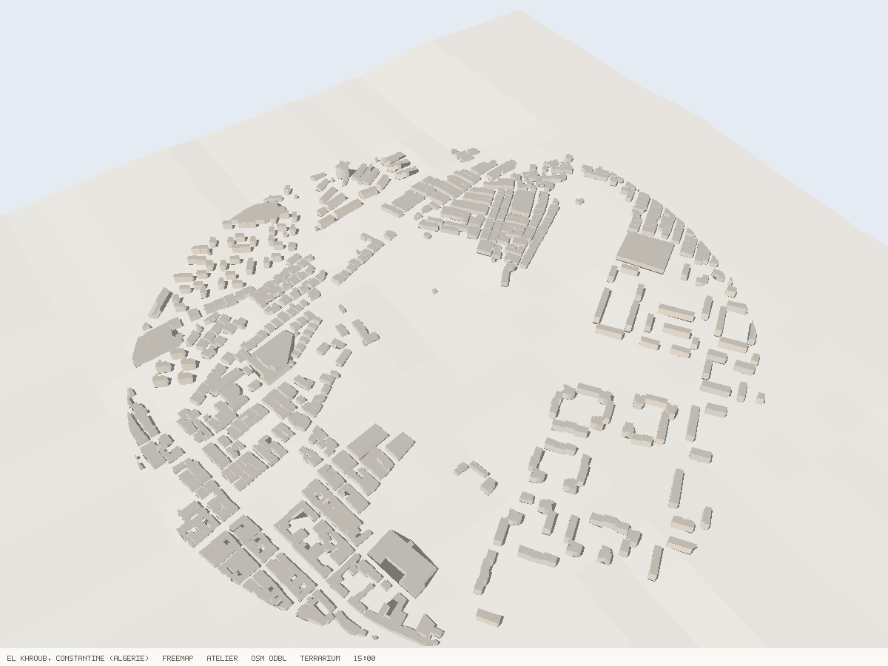

# UrbaTrame — lecture et analyse urbaine

**UrbaTrame** aide à lire et analyser un site urbain à partir de données cartographiques et territoriales. L’application rassemble des planches d’analyse, une visualisation 3D interactive et un atelier intégré pour explorer un lieu, consulter l’atlas administratif GADM et produire des livrables exploitables.

## Fonctionnalités

### Analyser le tissu urbain

- **46 analyses cartographiques** : voirie, occupation du sol, tissu urbain, densité, volumes bâtis, orientations, points d’intérêt, mobilité, bruit, ensoleillement, relief, climat et rose des vents NASA POWER/MERRA-2 à 10 m.
- **Occupation des bâtiments OpenBuildingMap** : empreintes coloriées par classe d’usage, parts classées/inconnues et synthèse des catégories, dans une couche facultative distincte des données OSM.
- **8 planches composées Max au format A3 paysage** : carte de contexte, pôles urbains, grille de densité, axonométrie annotée, encarts d’insertion, cônes de vue indicatifs, zonage fonctionnel OSM non réglementaire et analyse radiale.
- **Synthèse quantitative du site** : emprises bâties, espaces verts, linéaires de voirie, équipements, transports, relief et climat disponibles.
- **Scénario de capacité indicatif** : l’utilisateur saisit la surface du terrain, le FAR/COS, l’emprise et le nombre de niveaux; le coût n’est calculé que si un coût unitaire est fourni. Ces hypothèses ne valent pas autorisation réglementaire.
- **Choisir un site** par recherche de lieu ou coordonnées, puis définir un rayon de 200 à 3 000 m et une emprise circulaire ou polygonale.
- **Comparer la course solaire et les ombres** selon la date et l’heure choisies, dans les simulations 2D et 3D. La rose des vents est une statistique régionale à 10 m; elle ne simule pas le vent local entre les bâtiments.
- **Consulter les résultats** sous forme de planches lisibles et les exporter individuellement ou en planche A3.

### Explorer la ville en 3D

La vue 3D interactive permet de faire pivoter et d’incliner la scène, de zoomer, de choisir la date et l’heure solaires et d’examiner les bâtiments sur le relief. Les ombres, les fiches de bâtiments et l’export d’images sont accessibles depuis la vue.

Le rapport de site propose aussi un **générateur de volumes 3D conceptuels** : à partir de la capacité calculée selon les hypothèses saisies, l’utilisateur choisit le nombre de volumes, la hauteur d’étage, le rapport largeur/profondeur et l’écartement. La maquette en rangée peut être tournée à l’écran puis exportée en SVG, OBJ ou STL. Elle est schématique, non géoréférencée, ne représente aucune limite foncière et ne vérifie pas le zonage ni la réglementation.

### Utiliser l’atelier topographique Altiplan

**Altiplan est une section intégrée à UrbaTrame**, accessible depuis le bouton « Atelier topo » — ce n’est pas une application séparée. Elle permet de sélectionner un site sur la carte, de choisir les couches utiles, de prévisualiser les résultats et de préparer :

- un **plan topographique** avec courbes de niveau et couches cartographiques sélectionnées ;
- une **coupe de terrain** entre deux points ;
- une **maquette 3D** du terrain et des éléments cartographiés;
- des **repères et notes personnels** placés sur la carte, conservés dans le navigateur et exportables en GeoJSON.

L’atelier est accessible sans compte ni quota. Les notes restent locales à ce navigateur; elles ne sont ni synchronisées ni envoyées au serveur. Un exemple d’El Khroub est intégré pour découvrir l’interface sans attendre les services cartographiques externes.

L’**atlas administratif GADM**, ajouté dans l’Atelier Altiplan, permet de parcourir les pays et leurs subdivisions, de sélectionner les limites et leurs métadonnées, de consulter les aperçus thématiques GADM (altitude, température, précipitations et éclairage nocturne), puis de télécharger les données par pays ou pour le monde. Les téléchargements proposent les versions 4.1, 4.0.4 et 3.6 selon les formats officiels disponibles.

### Exporter et partager

| Contenu | Formats disponibles |
|---|---|
| Analyses cartographiques | SVG, PNG, planche A3 |
| Plan topographique | DXF, SVG, PNG |
| Coupe de terrain | DXF, SVG, PNG |
| Maquette 3D du terrain et des éléments cartographiés | OBJ, STL, aperçu PNG |
| Volumes 3D conceptuels | SVG, OBJ, STL |

Les exports topographiques peuvent être exprimés en mètres locaux ou géoréférencés en UTM WGS 84. Les analyses et les livrables peuvent être consultés dans les logiciels compatibles avec ces formats, notamment les outils de DAO/CAO.

### Adapter l’affichage

L’interface est disponible en français et en anglais. Elle propose un thème clair ou sombre, plusieurs palettes de couleur et des aperçus avant téléchargement.

## Exemples

Les exemples ci-dessous montrent des planches d’analyse et des livrables de l’atelier topographique pour El Khroub, Constantine.

## Données et limites

UrbaTrame s’appuie sur des données cartographiques d’**OpenStreetMap**, des empreintes et classes d’occupation **OpenBuildingMap**, des limites administratives **GADM**, des données de relief **AWS Terrarium**, des séries climatiques **NASA POWER** et une rose des vents issue de **MERRA-2**. La rose décrit le flux régional à 10 m; elle ne modélise pas les effets locaux des bâtiments et des rues. OpenBuildingMap est une couche facultative distincte des objets OSM; le flux public d’occupation ne fournit pas ici les hauteurs, surfaces de plancher ou la provenance par bâtiment. Les données OBM sont sous ODbL 1.0 : l’usage non commercial n’exonère ni d’attribution ni des conditions de partage à l’identique applicables aux bases dérivées publiées. Les données GADM sont utilisées selon l’autorisation commerciale et de redistribution confirmée pour UrbaTrame. La disponibilité et le niveau de détail varient selon les lieux et les sources consultées.

Les parcelles ne sont affichées que si leurs limites sont présentes dans OpenStreetMap. UrbaTrame **ne crée ni ne complète de limites juridiques ou cadastrales** : les cartes et maquettes ne remplacent pas un relevé de géomètre. Toute publication utilisant des données OpenStreetMap doit conserver l’attribution **© OpenStreetMap contributors**.

## Accès

L’exemple intégré d’El Khroub permet de découvrir les analyses et les exports. Dans la configuration actuelle, les **46 analyses sont accessibles sans compte, code de licence ni quota**.

## Documentation

- [Rapport de présentation](docs/UrbaTrame_Rapport_de_presentation.docx) · [Notice d’utilisation](docs/UrbaTrame_Notice_d_utilisation.docx)
- [Atelier topographique Altiplan](docs/ALTIPLAN.md) · [Atlas administratif GADM](docs/GADM.md)
- [Exports topographiques et CAO](docs/EXPORTS.md)
- [Visualisation 3D](docs/VUE3D.md)
- [Données, sources et attribution](docs/DONNEES.md)
- [API](docs/API.md)
- [Déploiement](docs/DEPLOIEMENT.md) · [Vercel](docs/VERCEL.md)

## Licence

Le code de l’application est sous licence [MIT](LICENSE). Les données restent soumises aux licences et conditions de leurs producteurs.
